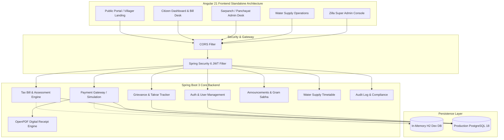
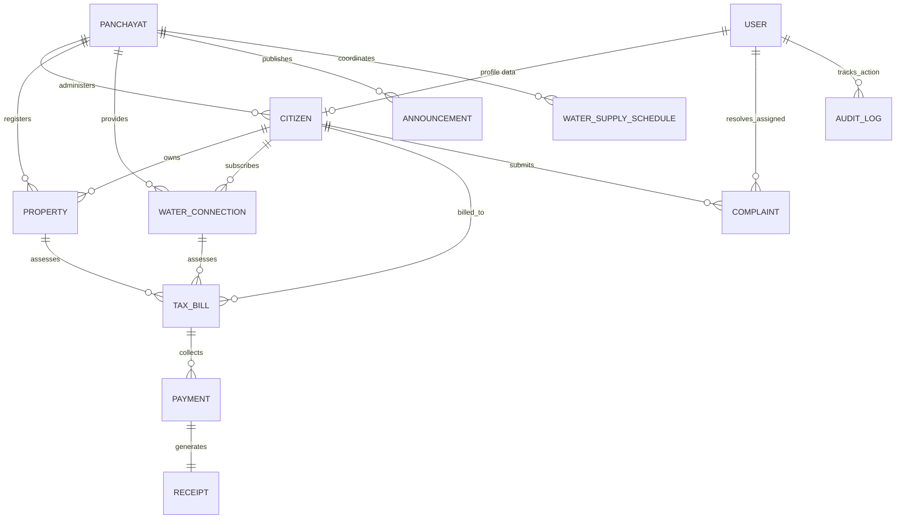

# GramSeva — Digital Gram Panchayat Portal
## Comprehensive Software Requirements Specification (SRS) & Architecture

---

### 1. Executive Summary & Problem Statement
Rural local governance in India (Panchayati Raj Institutions) faces several administrative and service-delivery bottlenecks:
- **Tax Collection Discrepancies:** Manual Namuna (register) book-keeping often leads to unrecorded dues, missing receipts, and delayed revenue realization for House Tax (*Ghar Patti*) and Water Tax (*Pani Patti*).
- **Water Distribution Unpredictability:** Rural water supply schedules change frequently due to tanker supply or pipeline maintenance without prior real-time communication to villagers.
- **Citizen Grievance Redressal:** Villagers currently have to visit the Panchayat office repeatedly to report broken streetlights, water leakages, or drainage blocks without transparency on who is assigned or when it will be fixed.
- **Gram Sabha Engagement:** Crucial public notices, meeting agendas, and welfare scheme deadlines struggle to reach remote wadis and wards.

**GramSeva** solves these challenges by providing an integrated, full-stack, multilingual-ready digital e-governance platform uniting the **Villagers (Citizens)**, **Sarpanch / Gram Sevak (Panchayat Admin)**, **Water Supply Staff**, and **Zilla Parishad / District Super Admin**.

---

### 2. System Architecture



---

### 3. Entity Relationship (ER) Diagram



---

### 4. User Roles & Permission Matrix

| Role | Primary Responsibilities | Authorized Endpoints |
| :--- | :--- | :--- |
| **PUBLIC (Unauthenticated)** | Village profile, notice board, water timings, bill lookup by Property ID | `/api/public/**` |
| **CITIZEN** | View house & water dues, pay bills online, download PDF receipts, track complaints | `/api/citizen/**`, `/api/public/**` |
| **SARPANCH / ADMIN** | Generate village tax bills, assign complaints to staff, publish Gram Sabha notices, revenue ledger | `/api/sarpanch/**`, `/api/citizen/**` |
| **WATER_SUPPLIER** | Ward-wise water distribution timetable, maintenance alerts, water leakage complaints | `/api/water/**` |
| **SUPER_ADMIN** | Manage Panchayat offices, toggle accounts, system audit log trail, analytics | `/api/admin/**` |

---

### 5. Default Demonstration Credentials

| Role | Username | Password | Full Name & Persona |
| :--- | :--- | :--- | :--- |
| **Citizen (Villager 1)** | `citizen1` | `Citizen@123` | Ramesh D. Patil (House #14, Ward 2) |
| **Citizen (Villager 2)** | `citizen2` | `Citizen@123` | Sunita M. Jadhav (House #27, Ward 1) |
| **Sarpanch Admin** | `sarpanch` | `Sarpanch@123` | Smt. Anandi Rao (Sarpanch, Shivane) |
| **Water Supply Staff** | `waterstaff` | `Water@123` | Dattatray Shinde (Water Supply In-charge) |
| **Super Admin** | `superadmin` | `Admin@123` | Zilla Parishad IT Administrator |

> **Tip:** The navigation header has a 1-click **Quick Demo Role** selector allowing instant role switching without retyping credentials.

---

### 6. Technology Stack Specifications

- **Backend:**
  - Java 17 LTS
  - Spring Boot 3.3.4
  - Spring Data JPA + Hibernate ORM
  - Spring Security 6 + JJWT 0.12.5 (Stateless HMAC-SHA256 tokens)
  - OpenPDF (Official digitally signed PDF receipt generation)
  - H2 Database Engine (Instant zero-friction testing)
  - PostgreSQL 18 production configuration ready (`localhost:3300/gramseva_db`)
- **Frontend:**
  - Angular 21 Standalone Architecture
  - TypeScript 5.8
  - Modern CSS3 Responsive Tokens & Glassmorphism UI
  - Google Fonts (Outfit & Plus Jakarta Sans) + Material Symbols Rounded
  - Pure reactive Angular signals & HttpClient

---

### 7. How to Run Locally

#### 1. Backend Service
```powershell
cd "d:\Gram Panchayat Project\backend"
mvn clean package -DskipTests
java -jar target/gramseva-backend-1.0.0.jar
# Backend will be active on http://localhost:8080
```

#### 2. Frontend Application
```powershell
cd "d:\Gram Panchayat Project\frontend"
npm start
# Web app will be accessible on http://localhost:4200
```
